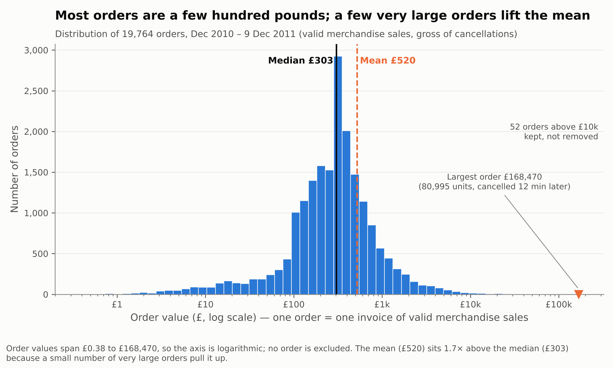
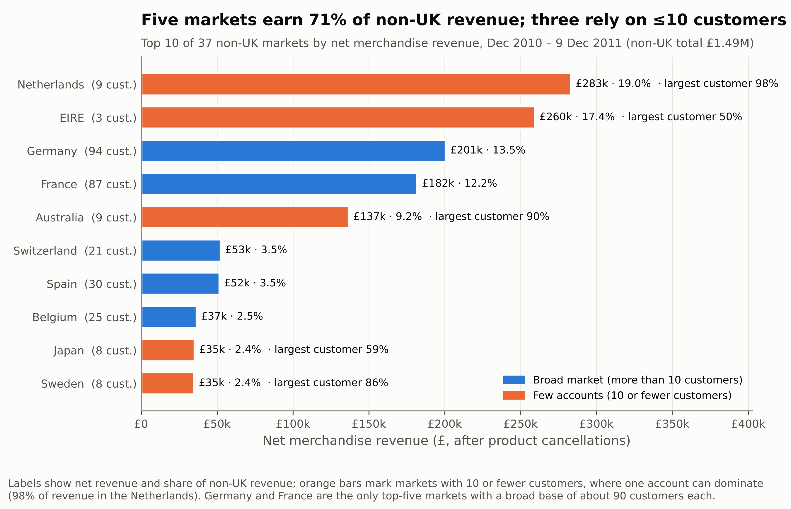
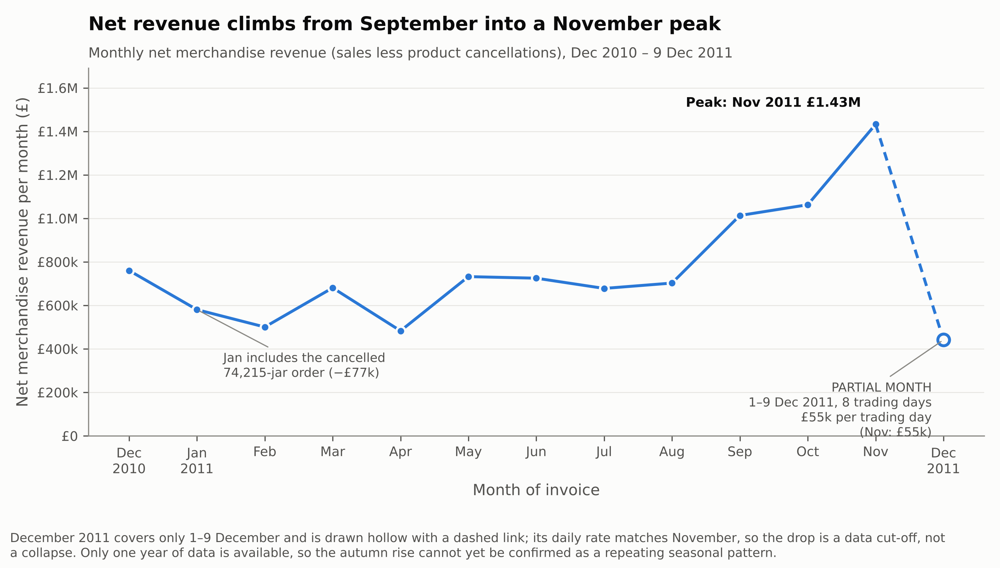
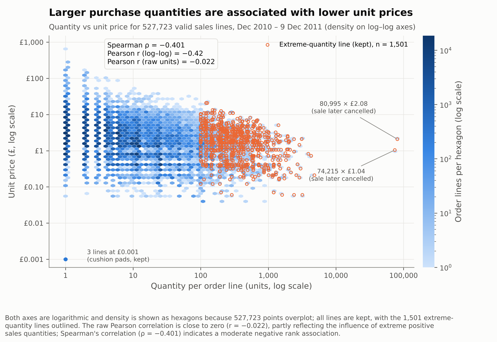
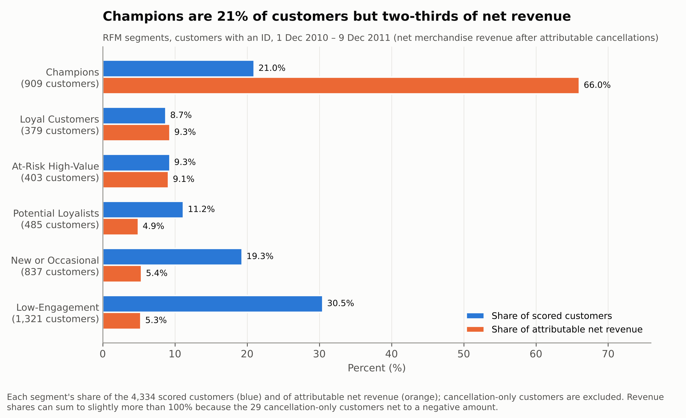

# Retail Store Analysis

Reproducible Python analysis of the UCI Online Retail dataset: 541,909 transaction lines from a UK-based online giftware retailer, covering 1 Dec 2010 to 9 Dec 2011.

**Business question:** which customers, products or markets should the retailer prioritise next year, and where is it losing revenue that it could recover?

**Approach:** no record is ever deleted or edited. Every cleaning decision is stored as a flag or derived column next to the original data, and each analysis is a filter on those flags. Every revenue total is checked to reconcile to the penny.

---

## Step 1 — Audit the data (`retail_audit.py`)

28 checks flag problems without changing anything. The main ones:

| Problem | Rows | Why it matters |
|---|---:|---|
| Missing CustomerID | 135,080 (24.93%) | Customer analysis covers only part of the business |
| Cancellations (invoice starts with "C") | 9,288 | −£896,812; gross and net revenue differ |
| Exact duplicate rows | 5,268 | Could inflate revenue and order counts |
| Non-product codes (postage, fees, manual entries) | 2,995 | Would rank as "products" |
| Zero or negative unit price | 2,517 | Free items, write-offs and bad-debt entries, not sales |
| Extreme lines (≥ 10,000 units or ≥ £5,000) | 38 | One 80,995-unit order dominates totals |
| Partial final month | — | December 2011 has only 8 trading days |

Output: `audit_output/`

## Step 2 — Clean and prepare (`retail_prepare.py`)

Each issue gets a documented rule, stored as a flag rather than a deletion:

- **Missing CustomerID:** kept for revenue, excluded from customer analysis.
- **Exact duplicates:** kept. There was no evidence of double recording: 70% are single-unit lines and 88% are not next to their original.
- **Repeated invoices:** 9 double entries already reversed by a cancellation are excluded together with that cancellation.
- **Product classification:** stock codes are split into products and 7 non-product classes.
- **Extreme quantities:** flagged with a reason but kept.

Revenue reconciliation:

| Step | Revenue |
|---|---:|
| All rows as loaded | £9,747,747.93 |
| = Net merchandise revenue (products, after product cancellations) | £9,792,708.88 |
| = Gross merchandise sales (before cancellations) | £10,268,089.30 |
| Net revenue from customers with an ID | £8,286,663.32 |

Output: `prepared/retail_prepared.csv.gz` (original columns plus all flags)

## Step 3 — Explore the data (`retail_eda.py`, `retail_eda_part3b.py`)

- **Order values are right-skewed.** Mean £519.53 against median £302.60, so the median describes a typical order.
- **The UK dominates:** 84.77% of net revenue. Non-UK orders are larger (median £386 vs £300) and cancel less (2.10% vs 5.07%).
- **Quantity and price move in opposite directions.** Spearman ρ = −0.401, while raw Pearson r = −0.022, because extreme quantities distort Pearson.

Output: `eda/`, `eda/part3b/`

## Step 4 — Visualise (`retail_charts.py`)

### 1. Order value distribution



**What it shows:** how the 19,764 orders are spread by value, on a log scale because values range from £0.38 to £168,470.

**Finding:** 77.7% of orders fall between £100 and £1,000, but the 52 orders above £10k carry 10.6% of gross sales. A few very large orders pull the mean (£520) well above the median (£303).

### 2. Top non-UK markets



**What it shows:** the 10 largest markets outside the UK by net revenue, with each market's customer count. Orange bars are markets with 10 or fewer customers.

**Finding:** the five largest markets earn 71% of non-UK revenue, but the top two are really individual accounts: one customer supplies 98% of the Netherlands' £283k, and Ireland's £260k comes from three customers. Germany (94 customers) and France (87) are the only broad international customer bases.

### 3. Monthly net revenue



**What it shows:** net revenue for each month. December 2011 is drawn hollow because it covers only 1–9 December.

**Finding:** revenue rises from September to a November peak of £1.43m. September–November produced 35.8% of the year's net revenue. December's low total reflects the data cut-off: its daily rate (£55k) matches November's. With one year of data, this can't yet be confirmed as a repeating seasonal pattern.

### 4. Quantity vs unit price



**What it shows:** every valid sales line, plotted as density on log–log axes. The 1,501 extreme-quantity lines are outlined and kept.

**Finding:** larger quantities are associated with lower unit prices (Spearman ρ = −0.401). The pattern holds within the same product (ρ = −0.43). That is consistent with bulk pricing, but product mix, customer type and price changes over time are alternative explanations.

## Step 5 — Segment customers with RFM (`retail_rfm.py`)

Each customer with an ID gets a score from 1 to 5 on three measures:

- **Recency:** days since their last purchase.
- **Frequency:** number of orders.
- **Monetary:** net revenue after cancellations.

The scores are combined into six segments.



**What it shows:** each segment's share of customers (blue) against its share of net revenue (orange).

**Finding:**
- **Champions** (909 customers, 21%) generate 66% of attributable net revenue, and the top 1% of customers (44) generate 30.3%.
- **At-Risk High-Value** customers (403) hold £755k, about as much as Loyal Customers, but haven't ordered for a median of 120 days.
- Removing suspected duplicates changes the segment of only 4 customers (0.09%).

Output: `rfm/customer_rfm.csv` (one row per customer) and summary tables

## Step 6 — Cancellations and markets (`retail_part6_evidence.py`)

Product cancellations total £475,380, 4.63% of gross sales. Split by timing:

| Type | Value | Share of cancelled value |
|---|---:|---:|
| Full reversal of an extreme-quantity order | £295,413 | 62.1% |
| Within 24 hours of purchase | £37,127 | 7.8% |
| 1–30 days after purchase | £86,339 | 18.2% |
| More than 30 days after purchase | £29,980 | 6.3% |
| No earlier purchase in the data / no customer ID | £26,521 | 5.6% |

Output: `part6/`

---

## Final findings

1. **Revenue is concentrated in existing customers.** Champions are 21% of customers but 66% of attributable net revenue, so retaining them matters more than acquiring new ones.
2. **There is a clear retention opportunity.** 403 At-Risk High-Value customers hold £755k of last year's revenue but have gone quiet. A controlled win-back pilot would show how much is recoverable.
3. **Germany and France are the only broad international markets.** The Netherlands and Australia each depend almost entirely on one customer and are better managed as key accounts.
4. **Less cancelled revenue is recoverable than the 4.6% headline suggests.** Most of it is reversals of extreme orders or same-day corrections. Only £116k (1.13% of gross sales) was cancelled a day or more after purchase, and its causes need recording before it can be targeted.

**Limitations:**
- Figures are revenue, not profit; there are no margins or costs.
- The data covers a single year.
- 15.4% of net revenue has no customer ID.
- Every relationship is an association, not a proven cause.

---

## How to run

```bash
pip install -r requirements.txt
python retail_audit.py data/online_retail.xlsx --out audit_output
python retail_prepare.py data/online_retail.xlsx --out prepared
python retail_eda.py prepared/retail_prepared.csv.gz --out eda
python retail_eda_part3b.py prepared/retail_prepared.csv.gz --out eda/part3b
python retail_charts.py prepared/retail_prepared.csv.gz --out charts
python retail_rfm.py prepared/retail_prepared.csv.gz --out rfm
python retail_part6_evidence.py --out part6
python make_figures.py   # optional compact figures
```

Steps 3–7 check that the cleaning flags are present and that revenue totals reconcile before they run.

## Data source and licence

Chen, D. (2015). *Online Retail* [Dataset]. UCI Machine Learning Repository. https://archive.ics.uci.edu/dataset/352/online+retail. Licensed under CC BY 4.0.
